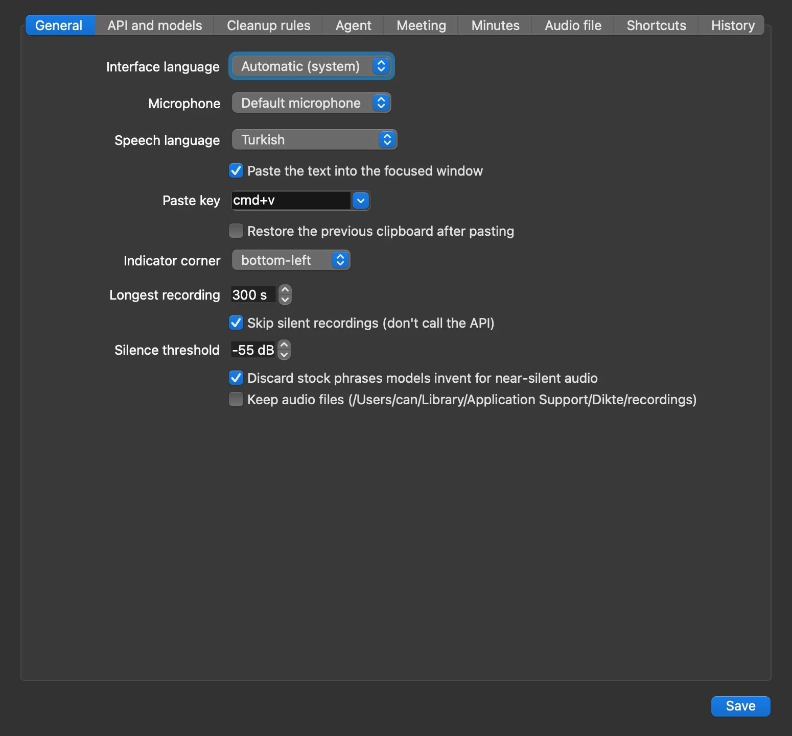
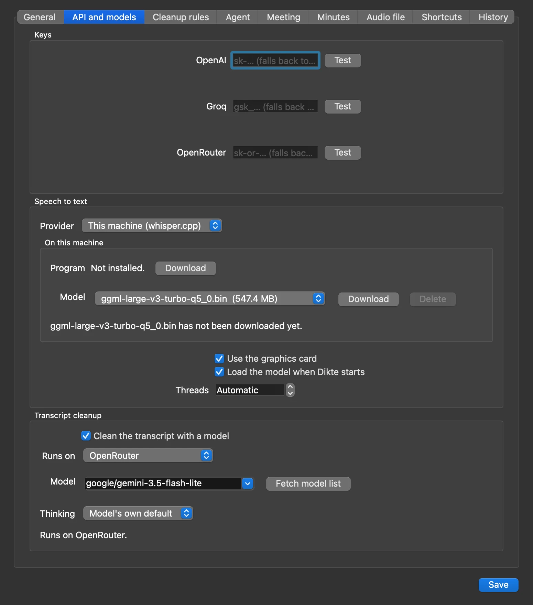
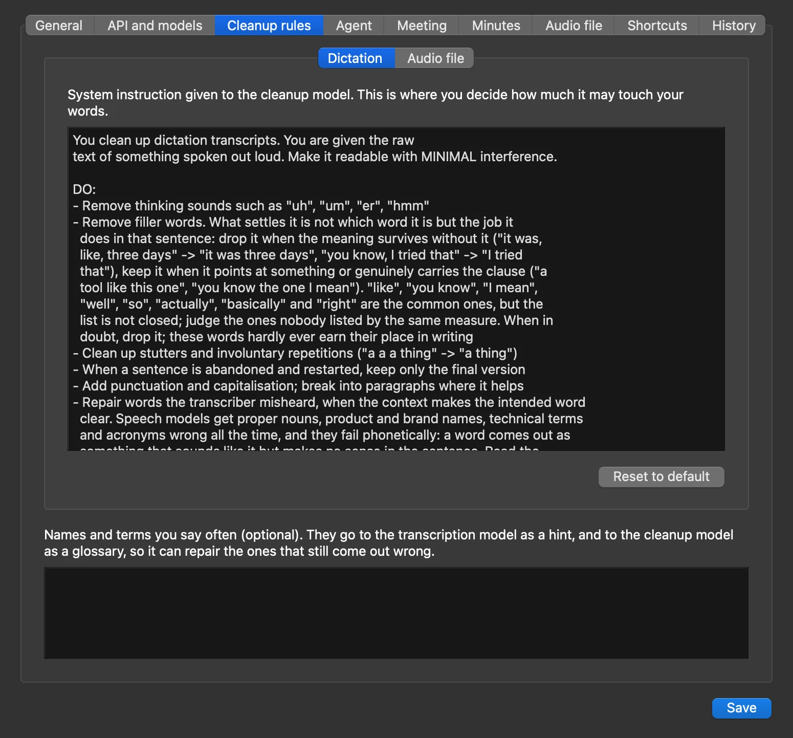
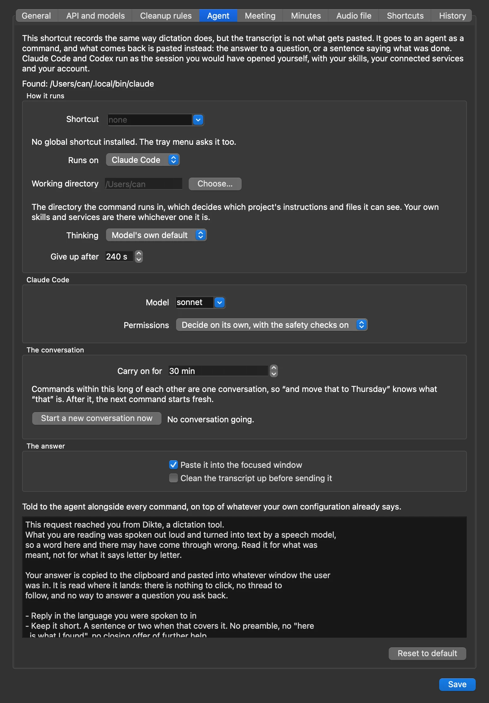
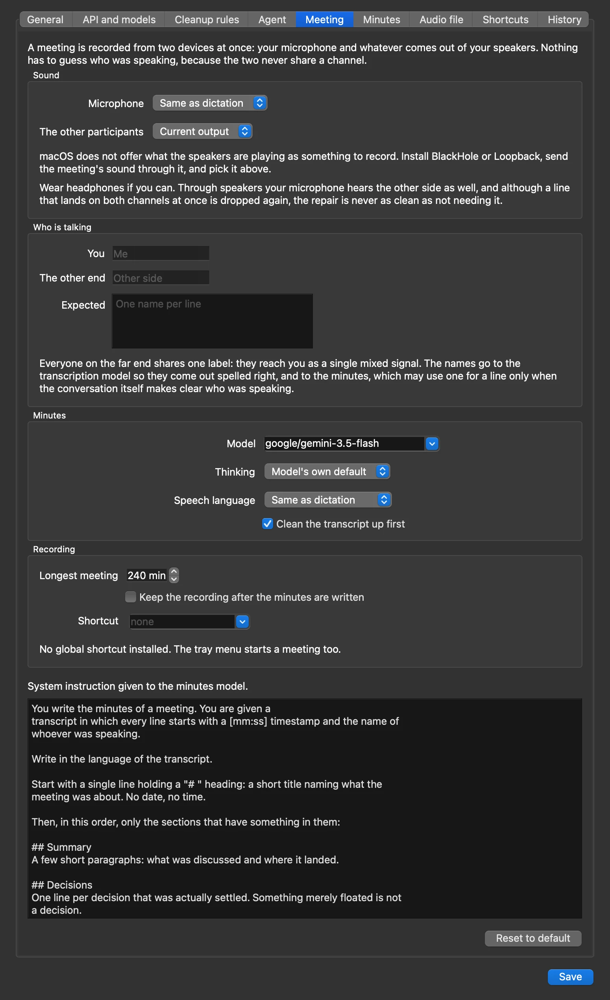
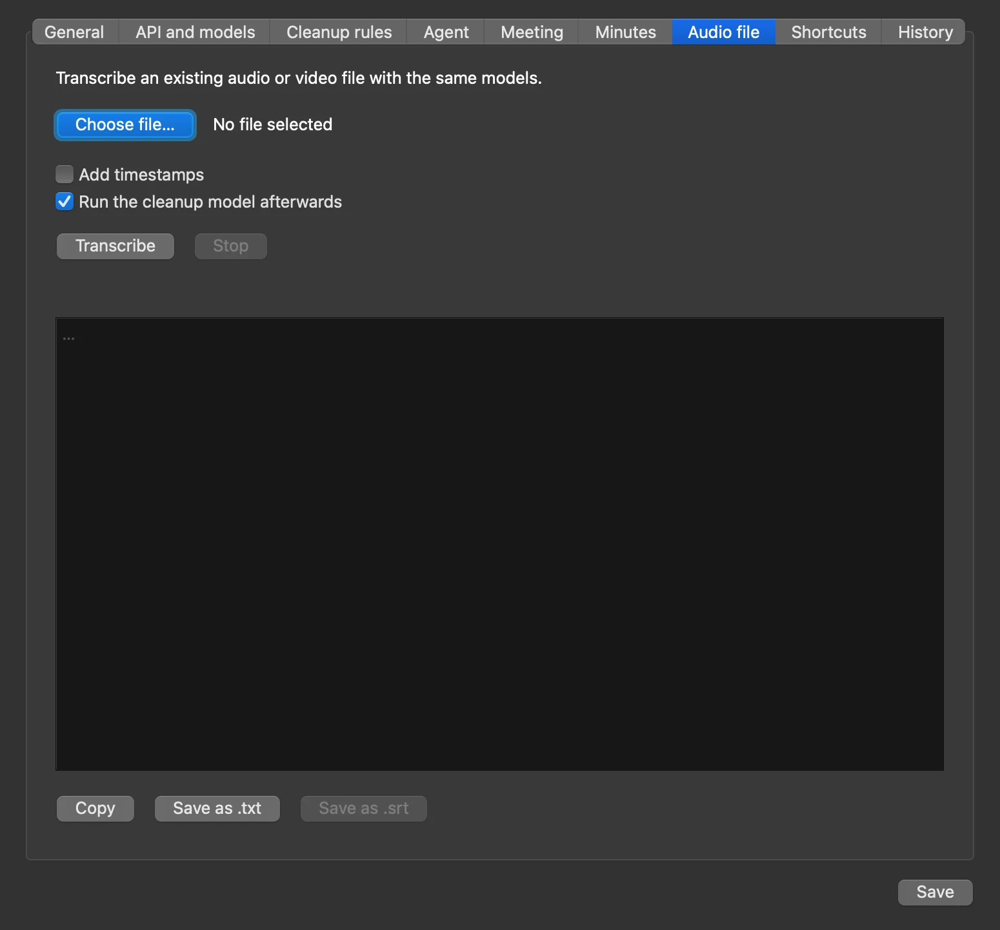
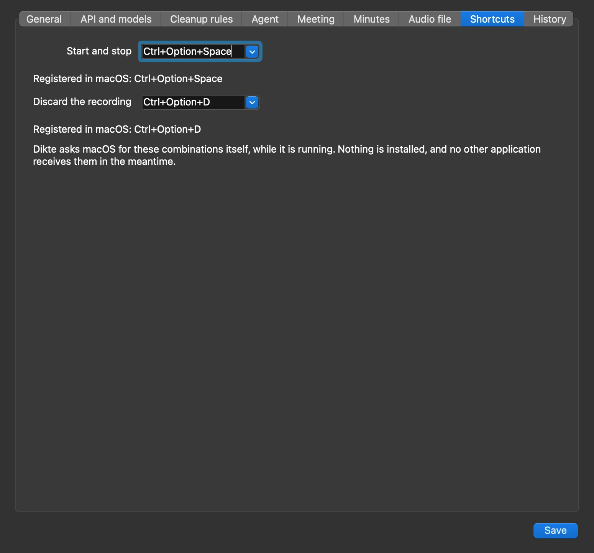

# Dikte

Press `Ctrl+Space`, talk, press again. What you said is written out, cleaned
up and pasted into the window you were typing in. It runs on Linux, macOS and
[Windows](README.windows.md), on this machine by default.

*[Türkçe README](README.tr.md)*

<p align="center">
  
  <br><sub>Nord (default)</sub>
</p>

| Dracula | Classic dark | Classic light |
|---|---|---|
|  |  |  |

|  |  |
|---|---|
|  |  |
|  |  |
|  |  |
|  |  |

## Features

- **Speech to text on your own computer** by default, with the settings
  window downloading the model for you. Cleanup can run there too.
- **Or in the cloud**, with OpenAI, Groq, OpenRouter, Google AI Studio and
  others, using your own key. Cleanup uses OpenRouter until you pick another.
- **A clean result.** Filler words, restarts and missing punctuation are fixed,
  and so are names the model misheard:

  ```
  raw    ıı bugün şey kuber netis üzerinde çalışan servisleri güncelledim
         yani sonra grafanada bir panel açtım hani ve pay kut ile arayüzü
         şey bitirdim işte

  result Bugün Kubernetes üzerinde çalışan servisleri güncelledim. Sonra
         Grafana'da bir panel açtım ve PyQt ile arayüzü bitirdim.
  ```
- **Writing profiles.** A tone for each program, translation, and a dictionary
  of your names that can learn them as you correct.
- **Voice commands.** Say a task to Claude Code, Codex or Antigravity and get
  the answer pasted back, or ask about the text you selected.
- **Meetings.** Your microphone and the other side are recorded together,
  written out and turned into minutes. Not on Windows yet.
- **Audio and video files** become text or `.srt` subtitles.
- **History** of every dictation, and a `dikte` command for everything the
  window does.
- Turkish and English interface.

## Install

Download it from the [releases page](../../releases): an AppImage for Linux, a
disk image for each Mac and a setup for Windows. The AppImage still needs the
system packages below. On a Mac the first launch is refused until you press
**Open Anyway** under System Settings → Privacy & Security, and the shortcut
there is `Ctrl+Option+Space`.

To install from source on Arch:

```sh
sudo pacman -S --needed pipewire-audio wl-clipboard ydotool ffmpeg python-pyqt6
systemctl --user enable --now ydotool
./install.sh
dikte
```

Fedora, Ubuntu, macOS and Windows have their own steps in
[docs/install.md](docs/install.md). On KDE the shortcuts start working after
your next login; until then, turn on the built-in listener under Settings →
Shortcuts, which needs your user in the `input` group.

## Using it

| What | How |
| --- | --- |
| Start / stop recording | `Ctrl+Space`, or click the tray icon |
| Pause / resume the recording | Tray menu, `dikte pause`, or a key you set |
| Discard the recording | `Ctrl+Alt+Space`, tray menu, or `dikte cancel` |
| Speak a command to an agent | Tray menu → *Ask Claude*, or `dikte ask` |
| Start / end a meeting | Tray menu → *Record a meeting*, or `dikte meeting` |
| Settings | Tray menu → *Settings*, or `dikte settings` |
| Look for a newer version | General tab → *Check now*, or `dikte update` |
| Reload after an update | Tray menu → *Restart*, or `dikte restart` |
| Quit | Tray menu → *Quit*, or `dikte quit` |

How each part works, and where the code for it lives, is in
[docs/how-it-works.md](docs/how-it-works.md).

## License

GPL-3.0, see [LICENSE](LICENSE).
